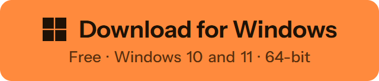

  

<h1 align="center">Keymotion</h1>

  A free, open-source Windows app for the AJAZZ AK980 PRO keyboard (also sold as AK980 V2): 
  lighting, key mapping, macros and your own GIFs on its little screen. No AJAZZ software needed.

  <b>English</b> · <a href="README.tr.md">Türkçe</a>

  <b>
    <a href="https://cebersaban44-rgb.github.io/keymotion/">User guide</a> ·
    <a href="https://github.com/cebersaban44-rgb/keymotion/releases">Release notes</a> ·
    <a href="https://github.com/cebersaban44-rgb/keymotion/discussions/categories/q-a">Questions</a>
  </b>

  

  Unofficial, not affiliated with AJAZZ · The installer isn't code-signed yet, so Windows may warn before it runs: <a href="#download-and-install">what to do</a>

  
  
  
  

  
   
  Keyboard scenes rendered with AI; the app's pages and what the keyboard's screen shows are real.
   
  <b>The 36-second video with sound: <a href="https://youtu.be/LvGvyJFhPIE">on YouTube</a></b>

  

## What it does

| | |
|---|---|
|  | **Lighting** The keyboard's 19 effects, a color for every key, and a live mirror of what the keys show. |
|  | **Key mapping** Change any key on the base and Fn layers: shortcuts, media keys, mouse buttons. |
|  | **Macros** Record a sequence by pressing keys, then edit each step and its timing. |
|  | **Screen studio** Put images, GIFs, videos and text cards on the 240×135 screen. |
|  | **Live screen** Cards that update on their own: the song that is playing, your next meeting, the focus timer. |
|  | **Focus and reminders** A focus timer, reminders and system gauges that light up on the keys. |

The [user guide](https://cebersaban44-rgb.github.io/keymotion/) goes through every page of the app.

## Supported keyboards

| | Keyboard | USB cable | 2.4 GHz receiver | Bluetooth |
|---|---|---|---|---|
|  | **AJAZZ AK980 PRO** also sold as AK980 V2 | Everything | Typing, media keys and the knob | Typing, media keys, the knob and the battery level |

Settings travel over the USB cable: that is how the keyboard is built. Several other keyboards appear to be built on the same platform and could be added once someone tests them. [See the list](https://cebersaban44-rgb.github.io/keymotion/help/keyboards/), and tell us if you have one.

## Download and install

1. Download the installer, `Keymotion_<version>_x64-setup.exe`, from the [latest release](https://github.com/cebersaban44-rgb/keymotion/releases/latest). It runs on Windows 10 and 11, 64-bit. The release page lists its SHA-256.
2. Run it and follow the steps.
3. Connect the keyboard with the USB cable and set the switch on its back to the middle (USB).

> [!NOTE]
> This first release isn't signed yet, so Windows may say "Windows protected your PC". Select **More info**, then **Run anyway**. If Smart App Control is on, Windows may block it outright; signed releases will fix that. See the [code signing policy](#code-signing-policy).

Good to know before you install:

- Keymotion is unofficial. It isn't made, endorsed or supported by AJAZZ.
- The installer is built by GitHub Actions from the code in this repository, and the release page lists its SHA-256.
- It collects no usage data, and it never updates the keyboard's firmware.

Updates: Keymotion checks GitHub for a new version once a day and asks before installing it. You can turn the check off in Settings.

## Safety

Keymotion only sends commands that were measured on a real keyboard, and firmware and bootloader updates are blocked in the code. Lighting, key assignments, macros and screen pictures are saved in the keyboard's memory, and you can always go back: [If something goes wrong](https://cebersaban44-rgb.github.io/keymotion/help/recovery/) shows how.

## Privacy

Keymotion collects nothing about you. It goes online for two things only: your calendar, if you add one, and a daily update check on GitHub, which you can turn off. Read the [privacy policy](PRIVACY.md).

## How Keymotion is made

I made Keymotion with Claude, an AI coding assistant. Claude wrote most of the code; I decided what it should do and tried every feature on my own AK980 PRO before it went in. Every change goes through a pull request and the automatic checks. Everything that talks to the keyboard was measured on the real keyboard first, and commands that could harm it are blocked in the code.

## Code signing policy

Keymotion 0.1.0 isn't signed yet. We're applying to SignPath Foundation for free code signing; once it's approved, this section will say so.

- Releases are built from this repository by GitHub Actions ([release workflow](.github/workflows/release.yml)).
- Committers and reviewers: [@cebersaban44-rgb](https://github.com/cebersaban44-rgb)
- Approvers: [@cebersaban44-rgb](https://github.com/cebersaban44-rgb)
- Privacy: see the [privacy policy](PRIVACY.md).

The full policy: [Code signing policy](https://cebersaban44-rgb.github.io/keymotion/about/code-signing/).

## Contributing

Bug reports, keyboard requests and ideas are welcome:

- [Report a bug](https://github.com/cebersaban44-rgb/keymotion/issues/new?template=bug.yml)
- [Ask for another keyboard](https://github.com/cebersaban44-rgb/keymotion/issues/new?template=keyboard.yml)
- [Questions and ideas](https://github.com/cebersaban44-rgb/keymotion/discussions)
- [Report a security problem privately](SECURITY.md)

Before you open a pull request, read [CONTRIBUTING.md](CONTRIBUTING.md).

## License

Keymotion is licensed under either of the [Apache License, Version 2.0](LICENSE-APACHE) or the [MIT license](LICENSE-MIT), at your option. Third-party software in the app is listed in [app/public/third-party-notices.txt](app/public/third-party-notices.txt).

Keymotion is an independent project. It is not affiliated with, endorsed by or supported by AJAZZ. Product names are used only to say which hardware this software works with. See [NOTICE](NOTICE).
