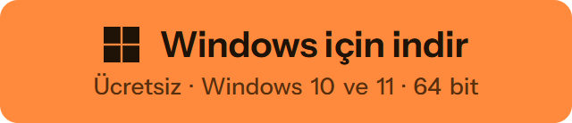

  

<h1 align="center">Keymotion</h1>

  AJAZZ AK980 PRO klavye (AK980 V2 adıyla da satılıyor) için ücretsiz, açık kaynak Windows uygulaması: 
  ışıklar, tuş atama, makrolar ve küçük ekranına kendi GIF'leriniz. AJAZZ'ın yazılımı gerekmez.

  <a href="README.md">English</a> · <b>Türkçe</b>

  <b>
    <a href="https://cebersaban44-rgb.github.io/keymotion/tr/">Kullanım kılavuzu</a> ·
    <a href="https://github.com/cebersaban44-rgb/keymotion/releases">Sürüm notları</a> ·
    <a href="https://github.com/cebersaban44-rgb/keymotion/discussions/categories/q-a">Sorular</a>
  </b>

  

  Resmî değildir, AJAZZ ile bağı yoktur · Kurulum dosyası henüz imzalı değil; Windows çalıştırmadan önce uyarabilir: <a href="#indirme-ve-kurulum">ne yapmalı</a>

  
  
  
  

  
   
  Klavye sahneleri yapay zekâyla üretildi; uygulamanın sayfaları ve klavyenin ekranında görünenler gerçektir.
   
  <b>36 saniyelik sesli video (İngilizce): <a href="https://youtu.be/LvGvyJFhPIE">YouTube'da</a></b>

  

## Neler yapar

| | |
|---|---|
|  | **Işıklar** Klavyenin 19 efekti, her tuşa ayrı renk ve tuşlarda görünenin canlı aynası. |
|  | **Tuş atama** Temel ve Fn katmanında her tuşu değiştirin: kısayollar, medya tuşları, fare düğmeleri. |
|  | **Makrolar** Tuşlara basarak bir dizi kaydedin, sonra her adımı ve süresini düzenleyin. |
|  | **Ekran stüdyosu** 240×135 ekrana görsel, GIF, video ve yazı kartı koyun. |
|  | **Canlı ekran** Kendiliğinden güncellenen kartlar: çalan şarkı, sıradaki toplantı, odak zamanlayıcısı. |
|  | **Odak ve hatırlatıcılar** Tuşlarda yanan odak zamanlayıcısı, hatırlatıcılar ve sistem göstergeleri. |

[Kullanım kılavuzu](https://cebersaban44-rgb.github.io/keymotion/tr/) uygulamanın her sayfasını tek tek anlatır.

## Desteklenen klavyeler

| | Klavye | USB kablo | 2.4 GHz alıcı | Bluetooth |
|---|---|---|---|---|
|  | **AJAZZ AK980 PRO** AK980 V2 adıyla da satılıyor | Her şey | Yazma, medya tuşları ve topuz | Yazma, medya tuşları, topuz ve pil düzeyi |

Ayarlar USB kablosundan gider; klavye böyle yapılmış. Başka birkaç klavye de aynı altyapıyla yapılmış görünüyor; biri denediğinde eklenebilirler. [Listeye bakın](https://cebersaban44-rgb.github.io/keymotion/tr/help/keyboards/), sizde varsa bize haber verin.

## İndirme ve kurulum

1. Kurulum dosyasını, `Keymotion_<sürüm>_x64-setup.exe`, [son sürümün sayfasından](https://github.com/cebersaban44-rgb/keymotion/releases/latest) indirin. Windows 10 ve 11'de (64 bit) çalışır. Dosyanın SHA-256 değeri aynı sayfada yazar.
2. Çalıştırıp adımları izleyin.
3. Klavyeyi USB kablosuyla bağlayın ve arkasındaki anahtarı ortaya (USB) getirin.

> [!NOTE]
> İlk sürüm henüz imzalı değil; Windows "Windows bilgisayarınızı korudu" diyebilir. **Ek bilgi**'yi, sonra **Yine de çalıştır**'ı seçin. Akıllı Uygulama Denetimi açıksa Windows kurulumu tamamen engelleyebilir; imzalı sürümler bunu çözecek. Ayrıntı için [kod imzalama politikasına](#kod-imzalama-politikası-code-signing-policy) bakın.

Kurmadan önce bilmeniz iyi olur:

- Keymotion resmî değildir. AJAZZ tarafından yapılmamış, onaylanmamış ve desteklenmez.
- Kurulum dosyası bu depodaki koddan GitHub Actions ile derlenir; sürüm sayfasında SHA-256 özeti yazar.
- Kullanım bilgisi toplamaz ve klavyenin yazılımını asla güncellemez.

Güncellemeler: Keymotion günde bir kez GitHub'da yeni sürüm olup olmadığına bakar ve kurmadan önce size sorar. Bu denetimi Ayarlar'dan kapatabilirsiniz.

## Güvenlik

Keymotion yalnızca gerçek bir klavyede ölçülmüş komutları gönderir; ürün yazılımı ve önyükleyici güncellemeleri kodda engellidir. Işıklar, tuş atamaları, makrolar ve ekran görselleri klavyenin belleğine kaydedilir ve her zaman geri dönebilirsiniz: nasıl yapılacağı [Bir şey ters giderse](https://cebersaban44-rgb.github.io/keymotion/tr/help/recovery/) sayfasında.

## Gizlilik

Keymotion hakkınızda hiçbir bilgi toplamaz. Yalnızca iki iş için internete çıkar: eklerseniz takviminiz ve GitHub'da günde bir kez güncelleme denetimi (kapatılabilir). [Gizlilik politikasını](https://cebersaban44-rgb.github.io/keymotion/tr/about/privacy/) okuyun.

## Keymotion nasıl yapılıyor

Keymotion'ı bir yapay zekâ kodlama yardımcısı olan Claude ile yaptım. Kodun çoğunu Claude yazdı; ne yapacağına ben karar verdim ve her özelliği eklenmeden önce kendi AK980 PRO'mda denedim. Her değişiklik bir PR'dan ve otomatik denetimlerden geçer. Klavyeyle konuşan her şey önce gerçek klavyede ölçüldü; klavyeye zarar verebilecek komutlar kodda engelli.

## Kod imzalama politikası (Code signing policy)

Keymotion 0.1.0 henüz imzalı değil. Ücretsiz kod imzalama için SignPath Foundation'a başvuruyoruz; onaylanınca bu bölümde yazacak.

- Sürümler bu depodan GitHub Actions ile derlenir ([sürüm iş akışı](.github/workflows/release.yml)).
- Yazan ve inceleyen: [@cebersaban44-rgb](https://github.com/cebersaban44-rgb)
- Onaylayan: [@cebersaban44-rgb](https://github.com/cebersaban44-rgb)
- Gizlilik: [gizlilik politikası](https://cebersaban44-rgb.github.io/keymotion/tr/about/privacy/).

Politikanın tamamı: [Kod imzalama politikası](https://cebersaban44-rgb.github.io/keymotion/tr/about/code-signing/).

## Katkıda bulunma

Hata bildirimleri, klavye istekleri ve fikirler memnuniyetle karşılanır. Türkçe yazabilirsiniz:

- [Hata bildirin](https://github.com/cebersaban44-rgb/keymotion/issues/new?template=bug.yml)
- [Başka bir klavye isteyin](https://github.com/cebersaban44-rgb/keymotion/issues/new?template=keyboard.yml)
- [Sorular ve fikirler](https://github.com/cebersaban44-rgb/keymotion/discussions)
- [Güvenlik sorununu gizlice bildirin](SECURITY.md)

PR açmadan önce [katkı rehberini](https://cebersaban44-rgb.github.io/keymotion/tr/developers/contributing/) okuyun.

## Lisans

Keymotion, seçiminize göre [Apache Lisansı 2.0](LICENSE-APACHE) ya da [MIT lisansı](LICENSE-MIT) ile lisanslanmıştır. Uygulamadaki üçüncü taraf yazılımlar [app/public/third-party-notices.txt](app/public/third-party-notices.txt) dosyasında listelenir.

Keymotion bağımsız bir projedir. AJAZZ ile bağlantısı yoktur, AJAZZ tarafından onaylanmamış ya da desteklenmemiştir. Ürün adları yalnızca uygulamanın hangi donanımla çalıştığını söylemek için kullanılır. [NOTICE](NOTICE) dosyasına bakın.
